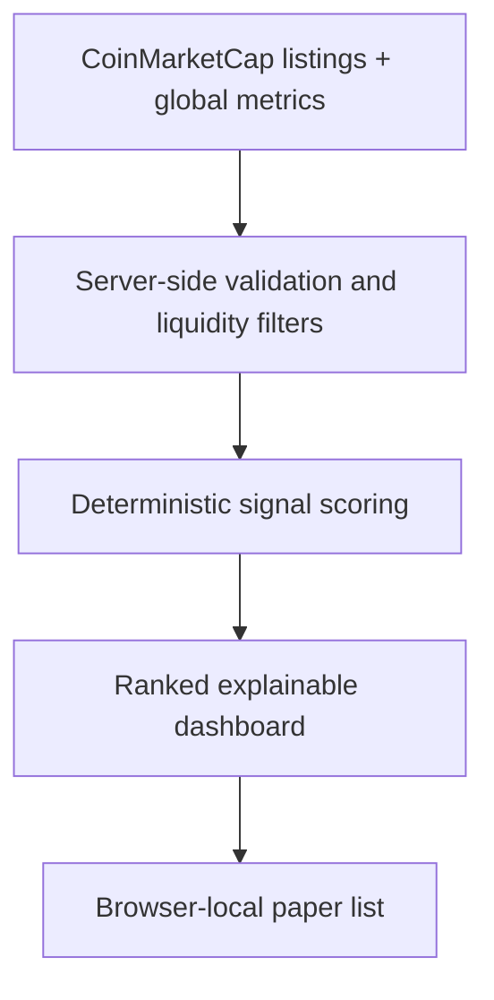

# Catalyst Edge

Catalyst Edge is an explainable market-signal engine built for the 2026 CoinMarketCap API Hackathon. It converts live CMC data into ranked, short-duration research setups with transparent levels and factor-by-factor scoring.

[Open the live demo](https://catalyst-edge.saptael.chatgpt.site) · [Watch the 24-second walkthrough](https://catalyst-edge.saptael.chatgpt.site/Catalyst_Edge_Demo.mp4) · [Read the submission package](SUBMISSION.md)

## What it does

- Fetches the top 100 cryptoassets and global market metrics from CoinMarketCap.
- Excludes stablecoins and assets with insufficient market cap, volume, or turnover.
- Scores momentum, liquidity, trend alignment, and market-regime agreement.
- Ranks the eight strongest long and short research signals.
- Calculates an entry band, target, invalidation level, and modeled loss on a fixed $100 paper allocation.
- Saves selected setups to a browser-local paper list; it never sends an order.
- Reports the CMC endpoints, UTC refresh time, and honest live/degraded status in the UI.

## How the score works

The deterministic model combines weighted 1-hour, 24-hour, and 7-day momentum; volume-to-market-cap turnover; directional agreement across those periods; and alignment with the global market-cap regime. Every component is visible in the selected setup's detail panel.

This prototype demonstrates explainable market screening. It is not an execution venue, financial advice, a backtest, or a promise of returns.

## CoinMarketCap API use

Production uses the account's authenticated CMC Startup API. `CMC_API_KEY` is stored only as a secret in the hosted runtime; judges need no credentials:

- `GET /v1/cryptocurrency/listings/latest`
- `GET /v1/global-metrics/quotes/latest`

Requests run server-side with a five-minute D1 snapshot shared by all production instances. An atomic 45-second lease prevents simultaneous upstream refreshes and rechecks freshness before acquisition. Temporary failures trigger 30-second to five-minute backoff; inactive access, authentication, permission, and daily/monthly quota failures wait at least 15 minutes. Rate limits honor `Retry-After`. Each upstream request has a ten-second timeout. When no runtime key is configured, a keyless/public Data API compatibility path is available. Production uses the authenticated API and retains the newest durable snapshot on failure. There is no embedded historical fallback. Invalid or empty data and source quotes over 20 minutes old are rejected. API responses disable browser/CDN caching, and the dashboard polls every 30 seconds while visible. Cached/stale responses never claim live endpoint evidence; fetched time and source quote time are displayed separately. No key is exposed to the browser or repository.

Refresh failures are saved separately from market data, so every instance reports the same safe `feedIssue` and `nextRetryAt`. The API records HTTP status and CMC's numeric error code without forwarding raw upstream messages or secrets. The dashboard shows the reason and cooldown, and stale data cannot be added to the paper list. The next successful refresh replaces the snapshot and clears the persisted error automatically.

HTTP 402 means CMC API access requires activation or renewal; changing the Site's key or retrying more often does not reactivate the subscription. The owner must restore access in the [CMC billing portal](https://pro.coinmarketcap.com/account/plan). No automatic plan purchase, key rotation, or paid-access fallback is performed. After access is restored, the next request after the cooldown refreshes the shared snapshot. The external hourly status monitor can trigger this request even when no dashboard tab is open; the Worker itself does not run a background timer.

## Architecture



Built with Next.js 16, React 19, TypeScript, Vinext/Vite, and Cloudflare Workers.

## Judge walkthrough

1. Check **CMC LIVE**, **CMC CACHED**, or **CMC STALE CACHE**, the UTC fetched time, and source quote time.
2. Compare the ranked setups and switch between **ALL**, **LONG**, and **SHORT**.
3. Select an asset to inspect its entry, target, invalidation, and modeled loss.
4. Review the momentum, liquidity, trend-alignment, and market-regime factors.
5. Add the setup to the browser-local paper list.
6. Verify the two CMC requests in **API evidence**.

## Local development

Requires Node.js 22.13 or newer.

```bash
npm ci
npm run dev
```

Run a production build with `npm run build`.

D1 binding `DB` and all generated `drizzle/` migrations are required. Deployment applies migrations before uploading the Worker. For local D1, apply migrations with Wrangler before requesting `/api/market`. Run `node --test tests/market-cache.test.mjs` for concurrency, cold-instance, outage, stale-response, lease-race, error sanitization, rate-limit, and reactivation recovery checks.

## Hackathon track

Markets and Trading Tools

## License

[MIT](LICENSE)
